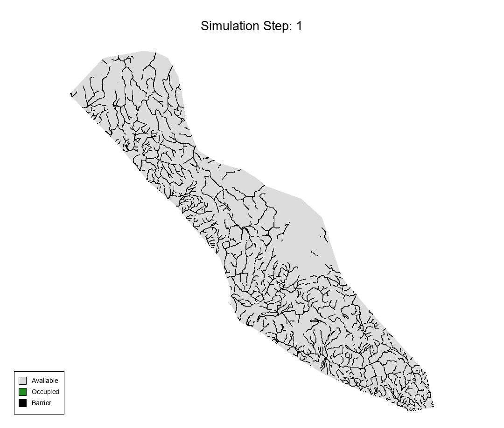
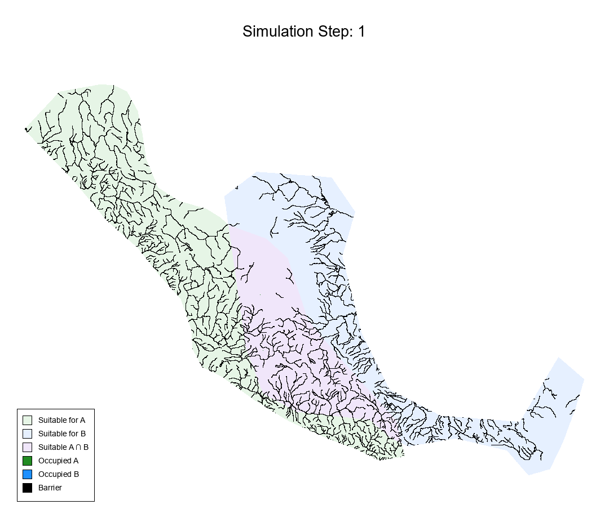
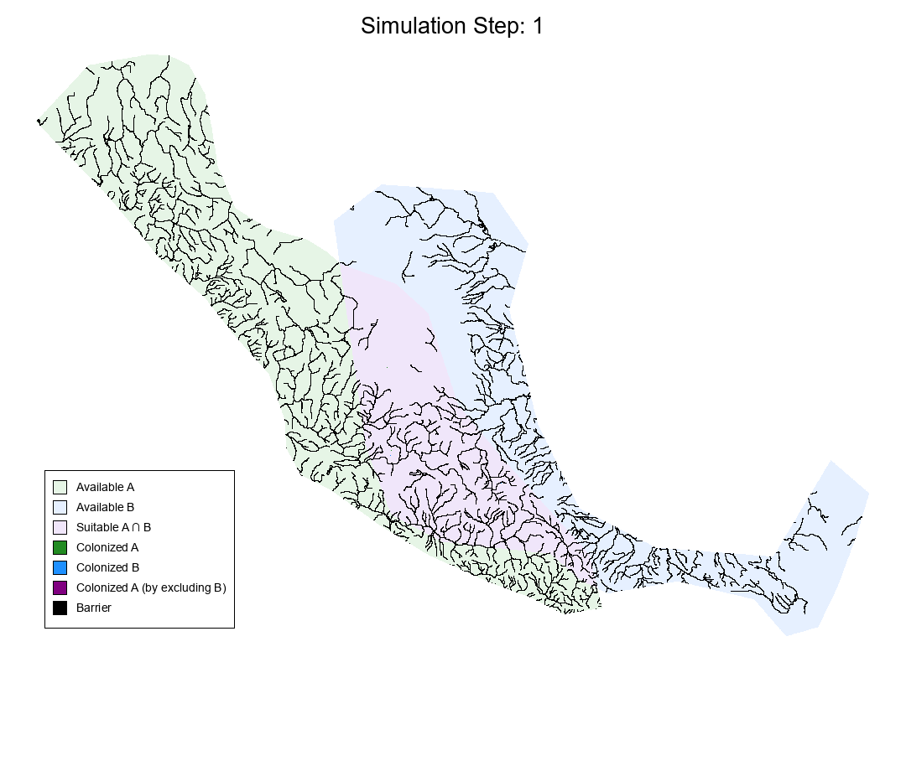
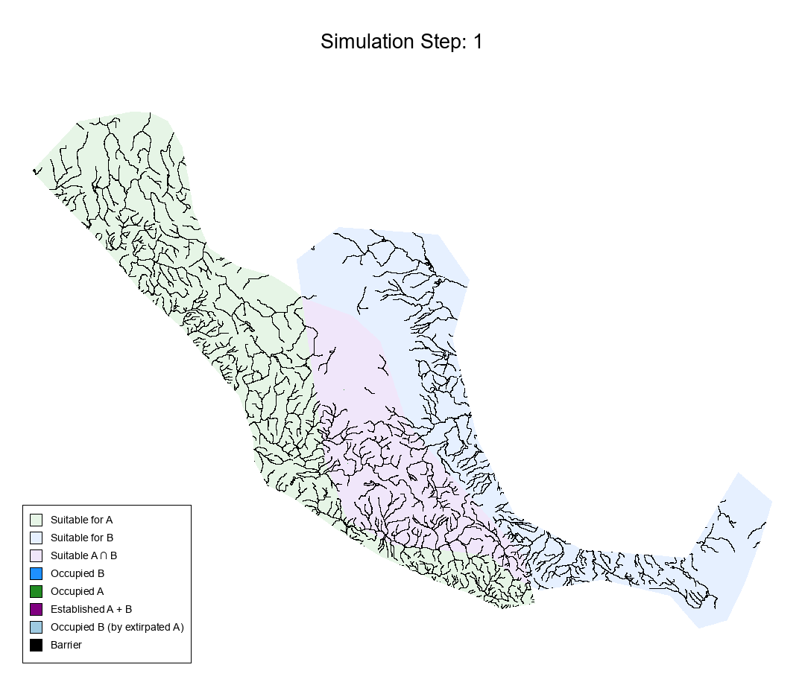
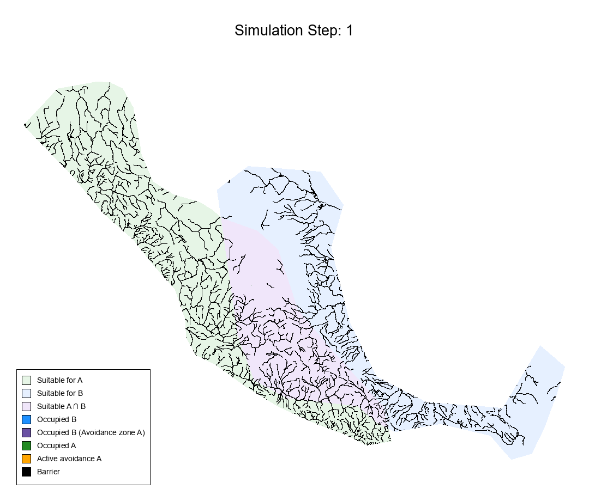
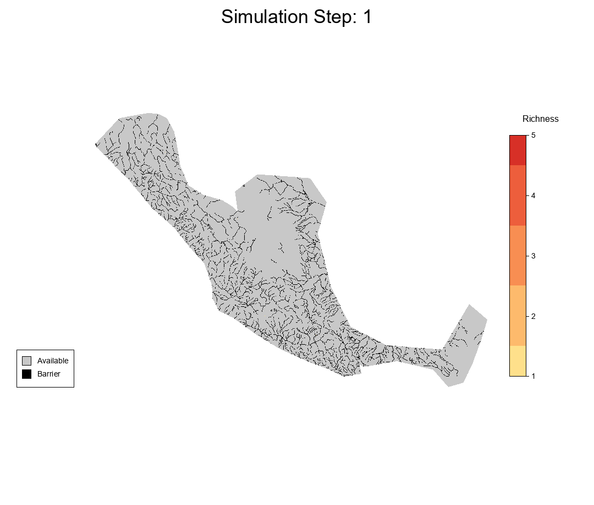

# activeFrontier

A Python package for simulating spatio-temporal species dispersal dynamics and biotic interactions (sympatry, competition, exclusion, obligate, facultative, parasitism, amensalism, and avoidance) across geographic landscapes, using raster suitability surfaces and occurrence records. Colonization is modeled with cellular automata that expand only from the **active frontiers** of each population.

## Prerequisites

- **Python** >= 3.9
- **FFmpeg**, installed and accessible in your system `PATH` (required only if `generate_gif=True`).

## Installation

You can install the package directly from GitHub via `pip`:

```bash
pip install git+https://github.com/PatronRiveroC/activeFrontier.git
```

## Importing the library

```python
import activefrontier as af
```

Or import the functions you need directly:

```python
from activefrontier import (
    single_sim,
    sympatry_sim,
    competition_sim,
    exclusion_sim,
    obligate_sim,
    facultative_sim,
    parasitism_sim,
    amensalism_sim,
    avoidance_sim,
)
```

## Example data

The package ships with example data (suitability rasters `rA.tif` and `rB.tif`, occurrence records `occA.csv` and `occB.csv`, and a barrier shapefile `hidro.shp`), so you can reproduce the results shown below.

```python
import os
from activefrontier import get_example_data

data = get_example_data()  # path to the folder with the bundled data

rA = os.path.join(data, "rA.tif")
occA = os.path.join(data, "occA.csv")
rB = os.path.join(data, "rB.tif")
occB = os.path.join(data, "occB.csv")
barrier = os.path.join(data, "hidro.shp")
out = "results/"
```

## Usage

The package has nine simulation functions. `single_sim` simulates one species; the others simulate two species (A and B) under a specific biotic interaction, except `sympatry_sim`, which works on folders of previous outputs.

### Single species

**`single_sim`**: simulates the dispersal of one species from its occurrence records over its suitability raster, limited by a barrier.

```python
single_sim(
    raster_path=rA,
    csv_path=occA,
    output_tif_path=os.path.join(out, "rA_sim.tiff"),
    barrier_path=barrier,
)
```



### Two-species interactions

All of these share the same arguments: `raster_path_A`, `csv_path_A`, `raster_path_B`, `csv_path_B`, `barrier_path` and `output_dir`. What changes is the interaction rule between species A and B.

| Function | Interaction |
|---|---|
| `competition_sim` | Both species compete for the same cells. |
| `exclusion_sim` | One species excludes the other from the cells it occupies. |
| `obligate_sim` | One species can only colonize where the other is present. |
| `facultative_sim` | One species benefits from the other, but does not depend on it. |
| `parasitism_sim` | One species benefits at the expense of the other. |
| `amensalism_sim` | One species is harmed while the other is unaffected. |
| `avoidance_sim` | One species avoids the cells occupied by the other. |

Example with `competition_sim` (the other functions are called the same way):

```python
competition_sim(
    raster_path_A=rA,
    csv_path_A=occA,
    raster_path_B=rB,
    csv_path_B=occB,
    barrier_path=barrier,
    output_dir=out,
)
```



Each function below is called with the same arguments; only the function name changes.

**`exclusion_sim`**

```python
exclusion_sim(
    raster_path_A=rA, csv_path_A=occA,
    raster_path_B=rB, csv_path_B=occB,
    barrier_path=barrier, output_dir=out,
)
```



**`obligate_sim`**

```python
obligate_sim(
    raster_path_A=rA, csv_path_A=occA,
    raster_path_B=rB, csv_path_B=occB,
    barrier_path=barrier, output_dir=out,
)
```


**`facultative_sim`**

```python
facultative_sim(
    raster_path_A=rA, csv_path_A=occA,
    raster_path_B=rB, csv_path_B=occB,
    barrier_path=barrier, output_dir=out,
)
```


**`parasitism_sim`**

```python
parasitism_sim(
    raster_path_A=rA, csv_path_A=occA,
    raster_path_B=rB, csv_path_B=occB,
    barrier_path=barrier, output_dir=out,
)
```


**`amensalism_sim`**

```python
amensalism_sim(
    raster_path_A=rA, csv_path_A=occA,
    raster_path_B=rB, csv_path_B=occB,
    barrier_path=barrier, output_dir=out,
)
```



**`avoidance_sim`**

```python
avoidance_sim(
    raster_path_A=rA, csv_path_A=occA,
    raster_path_B=rB, csv_path_B=occB,
    barrier_path=barrier, output_dir=out,
)
```



### Sympatry

**`sympatry_sim`**: instead of individual files, it takes **folders** containing the rasters and occurrence records (for example, the outputs of previous simulations) and simulates the species together.

```python
sympatry_sim(
    raster_path="results/output/",
    csv_path="results/output/",
    barrier_path=barrier,
    output_dir="results/output/",
)
```



## Vignette

An HTML vignette with a description of every function and a minimal reproducible example (using the bundled data) can be opened from Python:

```python
import activefrontier as af

af.vignette()
```

## License

This project is licensed under the MIT License. See the [LICENSE](LICENSE) file for details.
